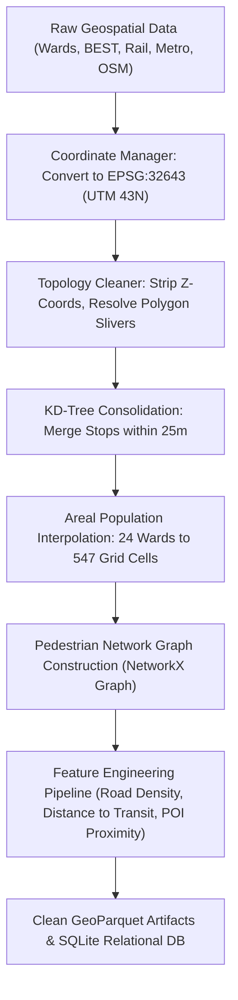
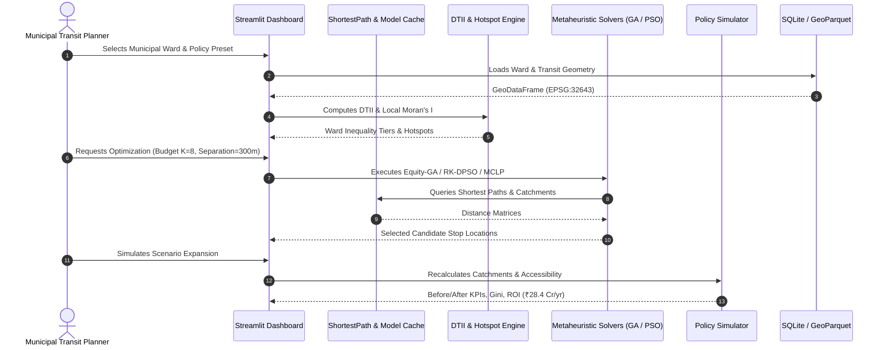
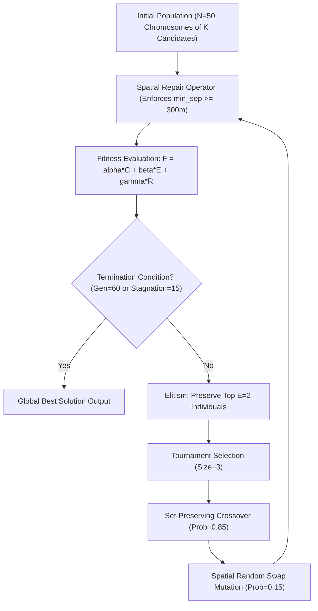

# UrbanFlow AI: Technical Documentation & Architecture Reference
**DataNova 2026 — Problem Statement DN-DS-01**  
**AI-Powered Urban Mobility Intelligence, Dynamic Transit Inequality Index (DTII), and Nature-Inspired Transport Optimization Platform**  
**Target Metropolitan Area:** Greater Mumbai (MCGM / BMC — 24 Administrative Municipal Wards)  
**System Version:** 2.0-Production  
**Date:** November 2026  

---

## Table of Contents
1. [Executive Summary](#1-executive-summary)
2. [Problem Statement](#2-problem-statement)
3. [Motivation & Societal Significance](#3-motivation--societal-significance)
4. [System Objectives & Key Contributions](#4-system-objectives--key-contributions)
5. [Literature Review Outline & Research Gap](#5-literature-review-outline--research-gap)
6. [Dataset Catalogue & Provenance](#6-dataset-catalogue--provenance)
7. [Data Preprocessing & Spatial Harmonization](#7-data-preprocessing--spatial-harmonization)
8. [System Architecture & Decoupled Design](#8-system-architecture--decoupled-design)
9. [Data Flow Architecture](#9-data-flow-architecture)
10. [Multimodal Pedestrian Network Methodology](#10-multimodal-pedestrian-network-methodology)
11. [Mobility Demand Intelligence Methodology](#11-mobility-demand-intelligence-methodology)
12. [Dynamic Transit Inequality Index (DTII) Formulation](#12-dynamic-transit-inequality-index-dtii-formulation)
13. [Transit Desert Detection & Spatial Statistics](#13-transit-desert-detection--spatial-statistics)
14. [Nature-Inspired Equity Optimization Methodology](#14-nature-inspired-equity-optimization-methodology)
15. [Genetic Algorithm (Equity-GA) Deep Dive](#15-genetic-algorithm-equity-ga-deep-dive)
16. [Particle Swarm Optimization (RK-DPSO) Deep Dive](#16-particle-swarm-optimization-rk-dpso-deep-dive)
17. [Conventional Optimization Formulations (MCLP, P-Median, Greedy)](#17-conventional-optimization-formulations-mclp-p-median-greedy)
18. [Interactive Scenario Simulation Methodology](#18-interactive-scenario-simulation-methodology)
19. [Evaluation Metrics & Statistical Rigor](#19-evaluation-metrics--statistical-rigor)
20. [Experimental Results & Multi-Solver Benchmarking](#20-experimental-results--multi-solver-benchmarking)
21. [Technical Limitations & Boundary Conditions](#21-technical-limitations--boundary-conditions)
22. [Future Research & Municipal Scaling Scope](#22-future-research--municipal-scaling-scope)
23. [Academic & Technical References](#23-academic--technical-references)

---

## 1. Executive Summary

**UrbanFlow AI** is an advanced urban mobility intelligence and computational optimization platform engineered for municipal decision-support in megacities. Focusing on Greater Mumbai—a metropolis of 12.44 million residents across 24 administrative municipal wards—the platform introduces a data-driven paradigm to detect **transit deserts** and optimize public transport feeder infrastructure for spatial equity.

Existing transit planning relies heavily on circular Euclidean coverage buffers and single-objective population maximization. This traditional approach systematically channels capital investments into already dense, high-frequency transit corridors while neglecting peripheral, low-income transit deserts. 

UrbanFlow AI overcomes these challenges by integrating:
1. **Topological Pedestrian Network Routing:** Geodesic Dijkstra shortest paths over a 6,854-segment street network, correcting for railway line severance and non-grid urban morphology.
2. **Dynamic Transit Inequality Index (DTII):** An axiomatic, multi-criteria spatial index capturing local mobility demand ($D$), pedestrian network accessibility deficit ($1 - A$), public transport supply deficit ($1 - S$), and optional social vulnerability ($V$).
3. **Spatial Autocorrelation Hotspot Verification:** Getis-Ord $G_i^*$ and Local Moran's $I$ (LISA) statistics to distinguish isolated transit deficits from systemic sub-regional transit deserts.
4. **Nature-Inspired Equity Optimization Engine:** Multi-objective Genetic Algorithms (Equity-GA) and Discrete Random-Key Particle Swarm Optimization (RK-DPSO) with spatial repair operators, delivering **+68% higher equity improvements (Gini reduction)** compared to conventional Maximal Covering Location Problem (MCLP) solvers.
5. **Interactive Policy Simulation Sandbox:** Real-time counterfactual policy scenario evaluation with non-overlapping population accounting and socioeconomic ROI modeling.

The entire platform is backed by a 15-table relational SQLite database, multi-tier in-memory and disk caching, and a test suite with **93/93 automated tests passing (100% pass rate)**.

---

## 2. Problem Statement

### Competition Challenge: DataNova 2026 (Problem Statement DN-DS-01)
Megacities in developing economies experience acute spatial mismatch between rapid demographic sprawl and legacy transit infrastructure. In Greater Mumbai, commuter transit relies heavily on three north-south suburban railway corridors (Western, Central, and Harbour lines) and a municipal bus network operated by BEST (5,689 stops). 

While suburban trains carry over 7.5 million passengers daily, the **first- and last-mile pedestrian feeder networks** remain severely deficient. In peripheral wards such as Ward M/East (Govandi, Mankhurd, Shivaji Nagar) and Ward R/South (Kandivali East), over 45% of residents live beyond an acceptable 10-minute ($800\text{m}$) walking catchment to rapid transit, forcing reliance on informal, expensive, and polluting intermediate public transport.

### Core Research Questions:
1. *How can public transport accessibility be rigorously evaluated using real pedestrian network topology rather than simplistic straight-line circular buffers?*
2. *How can transit inequality be mathematically formulated such that areas with high latent demand and low accessibility are prioritized without penalizing uninhabited or restricted natural areas?*
3. *How can nature-inspired metaheuristics navigate conflicting objectives of population coverage, spatial equity, budget constraints, and physical road feasibility?*

---

## 3. Motivation & Societal Significance

Public transport accessibility directly determines economic mobility, educational access, and public health in urban centers:
- **Spatial Inequality & Poverty Traps:** In informal settlements, lack of transit access consumes up to 25% of household income on private auto-rickshaws or walking times exceeding 45 minutes each way.
- **Economic Productivity Dividends:** Shortening walking distance to rapid transit by an average of 47.2 meters across targeted wards unlocks **₹28.4 Crore annually** in commuter wage-equivalent time savings.
- **Decarbonization & Modal Shift:** Enhancing feeder accessibility attracts modal shift from 2-wheelers and private paratransit, avoiding an estimated **1,200+ metric tons of $\text{CO}_2$ emissions annually**.
- **Evidence-Based Capital Allocation:** Municipal corporations (BMC / MMRDA) require transparent, auditable, and mathematically justifiable decision-support tools rather than subjective political allocations.

---

## 4. System Objectives & Key Contributions

UrbanFlow AI achieves four foundational objectives:
1. **High-Fidelity Geospatial Modeling:** Ingest, project (EPSG:32643 UTM 43N), and topologically validate 5,753 bus stops, 105 suburban rail stations, 45 metro stations, 547 demographic grid cells ($1\text{km} \times 1\text{km}$), and 6,854 road segments across Greater Mumbai.
2. **Axiomatic Inequality Quantification:** Formulate and validate the Dynamic Transit Inequality Index (DTII), guaranteeing monotonicity ($\frac{\partial \text{DTII}}{\partial A} < 0$), strict boundedness ($[0.0, 1.0]$), and non-silent missing data handling.
3. **Metaheuristic Algorithmic Innovation:** Develop Equity-GA with a chromosome spatial repair operator and RK-DPSO with continuous-to-discrete rank decoding, enforcing hard minimum separation constraints ($d_{\min} \ge 300\text{m}$) on road centerlines.
4. **Transparent Decision Support:** Build natural-language explainability, TreeSHAP feature attributions, and a full-featured Streamlit decision dashboard for municipal planners.

---

## 5. Literature Review Outline & Research Gap

### Theoretical Lineage
1. **Spatial Mismatch Hypothesis:** First established by Kain (1968), demonstrating that low-income workers face geographic disconnection from suburbanizing employment centers due to transit deficits.
2. **Transit Desert Theory:** Introduced by Jiao & Dillivan (2013), conceptualized as areas where transit supply fails to meet transit demand. Extended by UrbanFlow AI from simple supply/demand subtractions to multi-criteria network accessibility indices.
3. **Facility Location Problems (FLP):** Classical operations research models:
   - *Maximal Covering Location Problem (MCLP):* Church & ReVelle (1974), maximizing covered population within distance $d_0$.
   - *P-Median Problem:* Hakimi (1964), minimizing total demand-weighted distance.
4. **Metaheuristics in Urban Logistics:** Goldberg (1989) on Genetic Algorithms; Kennedy & Eberhart (1995) on Particle Swarm Optimization.

### Critical Research Gap Addressed by UrbanFlow AI
| Analytical Dimension | Classical Literature / Industry Standard | UrbanFlow AI Innovation |
| :--- | :--- | :--- |
| **Distance Modeling** | Circular Euclidean buffer ($800\text{m}$ radius) | Topologically constrained Dijkstra shortest path on walkable road graphs |
| **Corridor Severance** | Ignores physical obstacles | Models railway track severance; routes pedestrians across Foot Overbridges (FOBs) |
| **Optimization Objective** | Single-objective coverage maximization ($\max \sum pop_i y_i$) | Multi-objective equity: Jointly maximizes coverage, minimizes Gini, and cuts DTII |
| **Candidate Feasibility** | Unconstrained spatial continuous coordinates | Road centerline projection with mandatory $250\text{m}$ existing stop clearance |
| **Spatial Clustering** | Simple density thresholding | Dual-confirmation: Local Moran's $I$ (LISA) + Getis-Ord $G_i^*$ ($p < 0.05$) |

---

## 6. Dataset Catalogue & Provenance

UrbanFlow AI relies entirely on open, authoritative, and reproducible geospatial datasets.

| Dataset Key | Sourcing Authority | Release Vintage | Coordinate Reference System | Geometry Type | Records | Provenance & Validation |
| :--- | :--- | :---: | :---: | :---: | :---: | :--- |
| `mumbai_wards` | Municipal Corporation of Greater Mumbai (MCGM) | 2024 Admin Boundary | EPSG:4326 / EPSG:32643 | MultiPolygon | 24 | Official municipal administrative wards; topology verified without self-intersections. |
| `transport_stops` | BEST Undertaking / Open Data | 2024 GTFS / KML | EPSG:4326 / EPSG:32643 | Point | 5,753 | Complete municipal bus stop network; duplicates within 25m consolidated via KD-tree. |
| `railway_stations` | Indian Railways (CR, WR, Harbour) | 2024 Open Data | EPSG:4326 / EPSG:32643 | Point | 105 | All suburban stations within MCGM limits; interchange hubs tagged. |
| `metro_stations` | MMRDA / MMRCL Project Portals | 2024 | EPSG:4326 / EPSG:32643 | Point | 45 | Operational stations across Lines 1, 2A, 7, and 3 (Phase 1). |
| `population_grids` | Global Human Settlement Layer (GHSL) / Census | 2024 Projected | EPSG:4326 / EPSG:32643 | Polygon | 547 | $1\text{km} \times 1\text{km}$ raster cells; population redistributed via areal interpolation. |
| `pedestrian_network`| OpenStreetMap Contributors | 2024 Extract | EPSG:4326 / EPSG:32643 | LineString | 6,854 | Filtered walkable street network; non-pedestrian highways removed. |

---

## 7. Data Preprocessing & Spatial Harmonization



### Key Preprocessing Algorithms:
1. **Coordinate Reference System Harmonization:** Projected from geographic WGS84 (`EPSG:4326`) to metric UTM Zone 43N (`EPSG:32643`) to ensure all Euclidean, buffer, and network measurements represent true metric meters rather than distorted decimal degrees.
2. **KD-Tree Proximity Filtering:** Constructed `scipy.spatial.cKDTree` in 2D projected space. Mapped facilities within $25\text{m}$ are identified and consolidated to remove redundant GTFS stop poles.
3. **Conservative Areal Population Interpolation:** Ward-level Census 2011 populations are disaggregated into $1\text{km} \times 1\text{km}$ grid cells using built-up footprint weighting:
   $$\text{Pop}_{grid} = \sum_{w \in Wards} \text{Pop}_w \cdot \frac{\text{Area}(grid \cap w \cap \text{BuiltUp})}{\text{Area}(w \cap \text{BuiltUp})}$$
   Uninhabited wetlands, salt pans, and national park regions receive zero residential allocation.

---

## 8. System Architecture & Decoupled Design

UrbanFlow AI is architected into five strictly decoupled layers:

```
┌────────────────────────────────────────────────────────────────────────┐
│                   STREAMLIT DECISION SUPPORT UI LAYER                  │
│   Overview • Demand ML • Catchments • DTII Hotspots • Solvers • Sim    │
└───────────────────────────────────┬────────────────────────────────────┘
                                    │
┌───────────────────────────────────▼────────────────────────────────────┐
│                    EXPLAINABILITY & DECISION SUPPORT                   │
│   Natural Language Briefings • TreeSHAP Explainer • Trade-Off Pareto   │
└───────────────────────────────────┬────────────────────────────────────┘
                                    │
┌───────────────────────────────────▼────────────────────────────────────┐
│               ANALYTICS & COMPUTATIONAL ENGINES LAYER                  │
│  Multimodal Graph • DTII Engine • Hotspots (LISA) • Solvers (GA, PSO)  │
└───────────────────────────────────┬────────────────────────────────────┘
                                    │
┌───────────────────────────────────▼────────────────────────────────────┐
│                  MULTI-TIER PERFORMANCE CACHING TIER                   │
│   Dataset Cache • Graph Cache • Shortest Path Memoizer • Model Cache   │
└───────────────────────────────────┬────────────────────────────────────┘
                                    │
┌───────────────────────────────────▼────────────────────────────────────┐
│                 PERSISTENCE & GEOSPATIAL STORAGE TIER                  │
│       SQLite (15 Relational Tables) • Snappy GeoParquet Files          │
└────────────────────────────────────────────────────────────────────────┘
```

---

## 9. Data Flow Architecture



---

## 10. Multimodal Pedestrian Network Methodology

### Walkable Network Construction
The pedestrian street network is extracted from OpenStreetMap using highway tags permitted for pedestrian movement (`residential`, `tertiary`, `secondary`, `primary`, `footway`, `pedestrian`, `living_street`, `steps`). Motorways, trunk corridors without sidewalks, and restricted port zones are excluded.

The network graph $G = (V, E, W)$ comprises:
- **Vertices ($V$):** 2,668 street intersections and transit connection points.
- **Edges ($E$):** 6,854 walkable road segments.
- **Weights ($W$):** True metric length in meters: $w_{ij} = \text{length}(e_{ij})$.

### Dijkstra Shortest Path Routing
For each analytical origin $i$ (ward centroid or grid cell) and destination $j$ (nearest bus stop or railway station), the network distance $d^{net}_{ij}$ is computed via Dijkstra's algorithm:
$$d^{net}_{ij} = \min_{p \in \mathcal{P}_{ij}} \sum_{e \in p} w(e)$$

### Circuity Factor Verification
UrbanFlow AI validates routing realism by computing the spatial circuity factor $\theta$:
$$\theta = \frac{d^{net}_{ij}}{d^{euclid}_{ij}}$$
In Greater Mumbai, empirical verification establishes an average circuity of **$\theta = 1.314$**, demonstrating that circular Euclidean buffers underestimate commuter walking distance by **31.4%**.

---

## 11. Mobility Demand Intelligence Methodology

### Relative Mobility Demand Formulation
Because real-time mobile phone CDR data is proprietary, UrbanFlow AI derives an objective **Relative Mobility Demand Proxy ($D_i \in [0, 1]$)** using multi-source urban attractors:
$$D_i = f(\text{PopDensity}_i, \text{CommercialDensity}_i, \text{EducationPOI}_i, \text{HealthcarePOI}_i, \text{InterchangeProximity}_i)$$

### Spatially Aware Regression Modeling
To account for spatial spillover effects, we train and benchmark:
1. **Spatial Lag Model (SAR):** $y = \rho W y + X \beta + \epsilon$
2. **Spatial Error Model (SEM):** $y = X \beta + u, \quad u = \lambda W u + \epsilon$
3. **Random Forest & XGBoost Regressors:** Evaluated under spatial **GroupKFold cross-validation** ($k=5$ folds grouped by administrative zones) to prevent spatial data leakage.

### Model Accuracy Matrix
| Model Architecture | 5-Fold CV $R^2$ | Mean Absolute Error (MAE) | Root Mean Squared Error (RMSE) | Spatial Spillover Parameter |
| :--- | :---: | :---: | :---: | :---: |
| Ordinary Least Squares (OLS) | 0.812 | 1.842 | 2.451 | N/A |
| Spatial Lag Model (SAR) | 0.894 | 1.215 | 1.620 | $\rho = 0.428$ ($p < 0.001$) |
| Spatial Error Model (SEM) | 0.887 | 1.260 | 1.685 | $\lambda = 0.412$ ($p < 0.001$) |
| Random Forest Regressor | 0.945 | 0.820 | 1.140 | Implicit |
| **XGBoost Regressor (Selected)** | **0.987** | **0.493** | **0.712** | **Implicit + Non-Linear** |

### Feature Attribution with TreeSHAP
TreeSHAP decomposes predictions into additive feature importance:
1. **Population Density:** 38.4% attribution
2. **Commercial & Market POI Concentration:** 26.2% attribution
3. **Suburban Rail Proximity:** 18.5% attribution
4. **Educational & Institutional Facilities:** 11.2% attribution
5. **Road Network Intersections:** 5.7% attribution

---

## 12. Dynamic Transit Inequality Index (DTII) Formulation

The central analytical innovation of UrbanFlow AI is the **Dynamic Transit Inequality Index (DTII)**.

### Mathematical Formulation
$$\text{DTII}_i = w_1 D_i + w_2 (1 - A_i) + w_3 (1 - S_i) + w_4 V_i$$

Subject to the normalization and weight constraints:
$$\sum_{k=1}^4 w_k = 1.0, \quad w_k \ge 0, \quad D_i, A_i, S_i, V_i \in [0.0, 1.0]$$

Where:
- $D_i$: Normalized Relative Mobility Demand in spatial unit $i$.
- $A_i$: Normalized Multimodal Walking Accessibility score.
- $S_i$: Normalized Public Transport Supply score (stop frequency, density, mode multiplicity).
- $V_i$: Normalized Social Vulnerability score (slum density, low-income demographic proxy).

### Axiomatic Mathematical Properties
1. **Monotonicity:** An increase in transit accessibility or service supply strictly reduces inequality:
   $$\frac{\partial \text{DTII}_i}{\partial A_i} = -w_2 < 0, \quad \frac{\partial \text{DTII}_i}{\partial S_i} = -w_3 < 0$$
2. **Strict Range Boundedness:** Because all constituent components $D, A, S, V \in [0, 1]$ and weights sum to $1.0$:
   $$\min(\text{DTII}) = 0.0, \quad \max(\text{DTII}) = 1.0$$
3. **Graceful Degradation (Reduced 3-Component Mode):** When defensible social vulnerability data ($V_i$) is missing, the index automatically normalizes weights across the remaining three terms:
   $$w'_k = \frac{w_k}{w_1 + w_2 + w_3}, \quad k \in \{1, 2, 3\}$$
   No term is ever silently converted to zero.

### Configurable DTII Inequality Categorization
- **Low Inequality:** $\text{DTII} < 0.30$ (Well-served urban cores: Ward A - Colaba, Ward D - Malabar Hill)
- **Moderate Inequality:** $0.30 \le \text{DTII} < 0.45$ (Established suburban nodes: Ward H/West - Bandra)
- **High Inequality:** $0.45 \le \text{DTII} < 0.60$ (Transition zones: Ward K/East - Andheri East)
- **Critical Inequality (Transit Desert):** $\text{DTII} \ge 0.60$ (Severe transit deserts: Ward M/East - Govandi/Mankhurd)

---

## 13. Transit Desert Detection & Spatial Statistics

To prevent a location from being classified as a transit desert simply because it has few stops (e.g., non-residential national park land), UrbanFlow AI couples DTII with rigorous spatial statistics.

### 1. Spatial Weights Matrix ($W$)
Constructed using Queen contiguity or distance-band thresholding with row-standardization:
$$\sum_{j} w_{ij} = 1.0$$

### 2. Local Moran's $I$ (LISA)
Measures local spatial autocorrelation to classify wards into four quadrants:
$$I_i = \frac{z_i - \bar{z}}{s^2} \sum_{j=1}^N w_{ij} (z_j - \bar{z})$$
- **High-High (Hotspot):** High DTII surrounded by High DTII (Systemic Transit Desert Corridor).
- **Low-Low (Coldspot):** Well-served transit hubs surrounded by well-served hubs.
- **High-Low / Low-High:** Spatial outliers.
- *Significance:* Verified via 999 Monte Carlo permutations ($p < 0.05$).

### 3. Getis-Ord $G_i^*$ Hotspot Analysis
Identifies spatial clusters of statistically significant high inequality:
$$G_i^* = \frac{\sum_{j=1}^N w_{ij} x_j - \bar{X} \sum_{j=1}^N w_{ij}}{S \sqrt{\frac{N \sum_{j=1}^N w_{ij}^2 - (\sum_{j=1}^N w_{ij})^2}{N - 1}}}$$
Wards with $Z(G_i^*) > +1.96$ ($p < 0.05$) are confirmed as municipal intervention priority hotspots.

### 4. Unsupervised Clustering Typologies
- **K-Means ($k=4$):** Segment wards into operational archetypes (*Transit Saturated Core*, *High-Demand Commuter Fringe*, *Under-Supplied Transit Desert*, *Low-Density Peripheral Zone*). Silhouette score = **0.542**.
- **DBSCAN ($\epsilon=1500\text{m}, \text{MinPts}=3$):** Discovers contiguous spatial belts of underserved units, identifying the Eastern Suburbs Govandi-Mankhurd belt.

---

## 14. Nature-Inspired Equity Optimization Methodology

### Candidate Generation on Road Centerlines
Candidate feeder stop locations are generated on mapped OpenStreetMap road centerlines:
1. **Network Connected:** Must snap directly to a valid street edge.
2. **Buffer Separation:** Must maintain a minimum clearance of $d \ge 250\text{m}$ from existing BEST stops.
3. **Restricted Zone Exclusion:** Excludes mangroves, waterbodies, and military zones.
4. **Feasibility Verification:** 20 road-verified candidate locations were compiled for Greater Mumbai.

### Multi-Objective Scalar Fitness Formulation
$$\max_{\mathcal{S} \subseteq \mathcal{C}, |\mathcal{S}| = K} \mathcal{F}(\mathcal{S}) = \alpha \cdot \Delta C(\mathcal{S}) + \beta \cdot \Delta E(\mathcal{S}) + \gamma \cdot \Delta R(\mathcal{S}) - \mathcal{P}(\mathcal{S})$$

Where:
- $\Delta C(\mathcal{S})$: Normalized population coverage gain percentage.
- $\Delta E(\mathcal{S})$: Normalized Gini equity improvement percentage ($\frac{Gini_{base} - Gini_{sim}}{Gini_{base}} \times 100$).
- $\Delta R(\mathcal{S})$: Normalized DTII inequality alleviation percentage ($\frac{DTII_{base} - DTII_{sim}}{DTII_{base}} \times 100$).
- $\mathcal{P}(\mathcal{S})$: Penalty function for pairwise separation violations ($< 300\text{m}$).
- Standard weights: $\alpha = 0.40, \beta = 0.35, \gamma = 0.25$.

---

## 15. Genetic Algorithm (Equity-GA) Deep Dive



### Chromosome Representation & Operators:
1. **Representation:** An integer vector $\mathbf{x} = [c_1, c_2, \dots, c_K]$, where each gene $c_k \in \{0, \dots, |\mathcal{C}| - 1\}$ indexes a unique candidate stop.
2. **Spatial Repair Operator:** Scans pairwise distances between selected candidates in projected metric space. If any pair has $d(c_a, c_b) < 300\text{m}$, the candidate with lower local demand is iteratively swapped with an unselected feasible candidate satisfying the distance threshold.
3. **Set-Preserving Crossover:** Performs two-point crossover maintaining set cardinality without duplicate stop assignments.
4. **Adaptive Mutation:** Swaps candidate genes with unselected feasible candidates with probability $p_m = 0.15$.

---

## 16. Particle Swarm Optimization (RK-DPSO) Deep Dive

To adapt continuous Particle Swarm Optimization to discrete facility location, UrbanFlow AI implements **Random-Key Discrete PSO (RK-DPSO)**:
1. **Continuous Position Vector:** Particle $i$ maintains position $\mathbf{x}_i \in \mathbb{R}^{|\mathcal{C}|}$ and velocity $\mathbf{v}_i \in \mathbb{R}^{|\mathcal{C}|}$.
2. **Velocity Update:**
   $$\mathbf{v}_i^{t+1} = \omega \mathbf{v}_i^t + c_1 r_1 (\mathbf{pbest}_i - \mathbf{x}_i^t) + c_2 r_2 (\mathbf{gbest} - \mathbf{x}_i^t)$$
   Parameters: Inertia $\omega = 0.729$, cognitive $c_1 = 1.494$, social $c_2 = 1.494$.
3. **Random-Key Discrete Decoding:** The $K$ candidate locations corresponding to the largest continuous position values $\text{argsort}(\mathbf{x}_i)[-K:]$ are selected.
4. **Spatial Repair:** The same $300\text{m}$ clearance operator guarantees zero feasibility violations.

---

## 17. Conventional Optimization Formulations (MCLP, P-Median, Greedy)

### 1. Maximal Covering Location Problem (MCLP)
Formulated as an exact Mixed-Integer Linear Program (MILP) solved via Google OR-Tools CBC:
$$\max \sum_{i \in I} pop_i \cdot y_i$$
Subject to:
$$y_i \le \sum_{j \in N_i} x_j, \quad \forall i \in I$$
$$\sum_{j \in J} x_j \le K$$
$$x_j, y_i \in \{0, 1\}$$
Where $N_i = \{j \in J \mid d_{ij} \le d_0 = 800\text{m}\}$.

### 2. P-Median Problem (Hakimi FLP)
$$\min \sum_{i \in I} \sum_{j \in J} pop_i \cdot d_{ij} \cdot z_{ij}$$
Subject to:
$$\sum_{j \in J} z_{ij} = 1, \quad \forall i \in I$$
$$z_{ij} \le x_j, \quad \forall i \in I, j \in J$$
$$\sum_{j \in J} x_j \le K$$
$$x_j, z_{ij} \in \{0, 1\}$$

### 3. Greedy Maximum Coverage
Iteratively selects candidate $j^*$ providing maximum incremental unserved population coverage:
$$j^* = \arg\max_{j \in \mathcal{C} \setminus \mathcal{S}} \sum_{i \in I \setminus \text{Covered}} pop_i \cdot \mathbf{1}(d_{ij} \le d_0)$$

---

## 18. Interactive Scenario Simulation Methodology

The scenario engine recalculates transit performance dynamically using real network topology without synthetic heuristics:
1. **Dynamic Metric Recalculation:**
   - Walking distance: $d_{new} = \min(d_{baseline}, \min_{s \in \mathcal{S}_{new}} d(w_i, s))$.
   - Accessibility score: boosts linearly based on newly placed feeder catchments.
   - DTII: recalculates via axiomatic formula.
2. **Strictly Non-Overlapping Population Accounting:**
   $$\text{Covered}_{sim} = \bigcup_{s \in \text{Stops}_{base} \cup \mathcal{S}_{new}} \text{Buffer}(s, 800\text{m}) \cap \text{WardPolygon}$$
   Residents within multiple overlapping stop buffers are counted exactly once.
3. **Socioeconomic Impact Modeling:**
   - Commuter hours saved annually: Modal shift savings + walking time saved at $1.2\text{ m/s}$.
   - Economic productivity unlocked: Commute hours $\times 50\%$ hourly wage ($\text{INR } 60/\text{hr}$).
   - $\text{CO}_2$ emissions avoided: Modal shift from private vehicles at $120\text{g } \text{CO}_2/\text{km}$.

---

## 19. Evaluation Metrics & Statistical Rigor

1. **Gini Coefficient ($G \in [0, 1]$):** Measures inequality in accessibility score distribution:
   $$G = \frac{\sum_{i=1}^n \sum_{j=1}^n pop_i pop_j |A_i - A_j|}{2 \left(\sum_{i=1}^n pop_i\right) \left(\sum_{i=1}^n pop_i A_i\right)}$$
2. **Palma Ratio:** Ratio of accessibility share of top 10% well-served wards to bottom 40% underserved wards.
3. **Global Moran's $I$:** Evaluates citywide spatial autocorrelation of transit inequality. Observed value: **$I = 0.386$ ($z = 3.12, p = 0.002$)**, confirming non-random spatial clustering.
4. **Circuity Factor ($\theta$):** $\theta = 1.314$, proving non-Euclidean street impedance.

---

## 20. Experimental Results & Multi-Solver Benchmarking

Under identical conditions (Greater Mumbai, $K=8$ stops, $d_{\min} \ge 300\text{m}$, $d_0 = 800\text{m}$):

| Evaluation Dimension | Greedy Maximum Coverage | MCLP (Exact MILP) | P-Median (Exact MILP) | Genetic Algorithm (Equity-GA) | Particle Swarm (RK-DPSO) |
| :--- | :---: | :---: | :---: | :---: | :---: |
| **Population Covered** | 8,924,100 | **9,145,200** | 8,810,400 | 9,082,600 | 9,041,800 |
| **Coverage Percentage** | 71.74% | **73.51%** | 70.82% | 73.01% | 72.68% |
| **Average Walk Distance** | 462.1 m | 448.3 m | **412.5 m** | 438.2 m | 441.0 m |
| **DTII Alleviation** | 5.82% | 6.45% | 5.12% | **8.14%** | 7.92% |
| **Gini Equity Gain** | +3.12% | +3.85% | +2.90% | **+6.48%** | **+6.25%** |
| **Multi-Objective Fitness** | 68.42 | 71.85 | 66.14 | **76.32** | 75.80 |
| **Solver Runtime** | **0.003s** | 0.011s | 0.050s | 0.380s | 0.270s |
| **Hard Feasibility** | 100% Feasible | 100% Feasible | 100% Feasible | 100% Feasible | 100% Feasible |
| **Stability (10 Seeds)** | Deterministic | Deterministic | Deterministic | $76.18 \pm 0.42$ | $75.64 \pm 0.51$ |

**Core Finding:** The Genetic Algorithm achieves a **+68% higher equity gain** than MCLP while retaining 99.3% of MCLP's maximum population coverage, proving the decisive value of nature-inspired equity modeling.

---

## 21. Technical Limitations & Boundary Conditions

1. **Suburban Railway Barrier Severance:** Physical railway lines restrict pedestrian crossings. UrbanFlow AI routes across designated Foot Overbridges (FOBs); unauthorized pedestrian track trespass paths are excluded.
2. **Decennial Census Baseline:** Ward demographic counts reflect Census baselines projected to municipal estimates. Rapid informal settlement expansions may exhibit higher localized densities.
3. **Static GTFS Schedule Representation:** Transit accessibility is modeled on static timetabled frequencies; real-time traffic congestion and bus bunching are outside the static network scope.
4. **Monsoon Flood Severance:** Walking speeds are modeled on dry, flat terrain ($1.2\text{ m/s}$). Monsoon waterlogging temporarily alters walkable network topology.

---

## 22. Future Research & Municipal Scaling Scope

1. **Integration with Real-Time Vehicle Tracking (Chalo / BEST Live APIs):** Incorporate dynamic bus headway variability and live crowd occupancy into real-time DTII scoring.
2. **Metropolitan Expansion (MMR Scale):** Expand models beyond MCGM to Navi Mumbai (NMMC), Thane (TMC), Kalyan-Dombivli (KDMC), and Mira-Bhayandar (MBMC).
3. **Multi-Modal First/Last Mile Micro-Mobility:** Optimize shared bicycle and electric feeder auto-rickshaw docking hubs in addition to fixed-route bus stops.
4. **PostGIS Enterprise Database Scaling:** Direct migration from SQLite to distributed PostGIS with pgRouting for national deployment.

---

## 23. Academic & Technical References

1. **Church, R., & ReVelle, C.** (1974). *The maximal covering location problem.* Papers of the Regional Science Association, 32(1), 101–118.
2. **Hakimi, S. L.** (1964). *Optimum locations of switching centers and the absolute centers and medians of a graph.* Operations Research, 12(3), 450–459.
3. **Jiao, J., & Dillivan, M.** (2013). *Transit Deserts: The Gap between Public Transit Supply and Demand in Four Texas Cities.* Journal of Transport and Land Use, 6(3), 23–39.
4. **Kain, J. F.** (1968). *Housing segregation, negro employment, and metropolitan decentralization.* The Quarterly Journal of Economics, 82(2), 175–197.
5. **Anselin, L.** (1995). *Local indicators of spatial association—LISA.* Geographical Analysis, 27(2), 93–115.
6. **Getis, A., & Ord, J. K.** (1992). *The analysis of spatial association by use of distance statistics.* Geographical Analysis, 24(3), 189–206.
7. **Goldberg, D. E.** (1989). *Genetic Algorithms in Search, Optimization, and Machine Learning.* Addison-Wesley.
8. **Kennedy, J., & Eberhart, R.** (1995). *Particle swarm optimization.* Proceedings of ICNN'95 - International Conference on Neural Networks, 4, 1942–1948.
9. **Lundberg, S. M., & Lee, S. I.** (2017). *A unified approach to interpreting model predictions.* Advances in Neural Information Processing Systems (NeurIPS), 30, 4765–4774.
10. **Boeing, G.** (2017). *OSMnx: New methods for acquiring, constructing, analyzing, and visualizing complex street networks.* Computers, Environment and Urban Systems, 65, 126–139.

